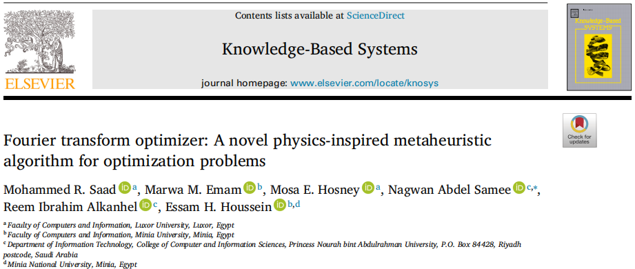
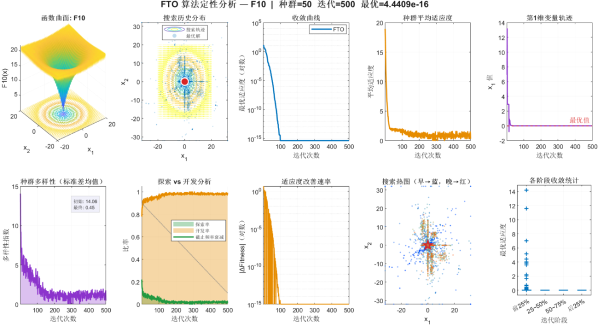
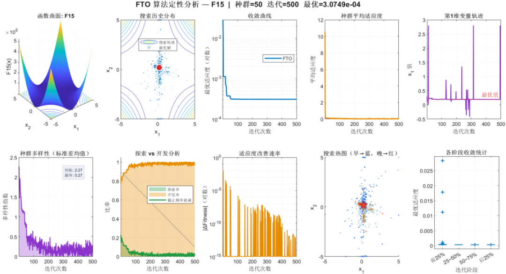
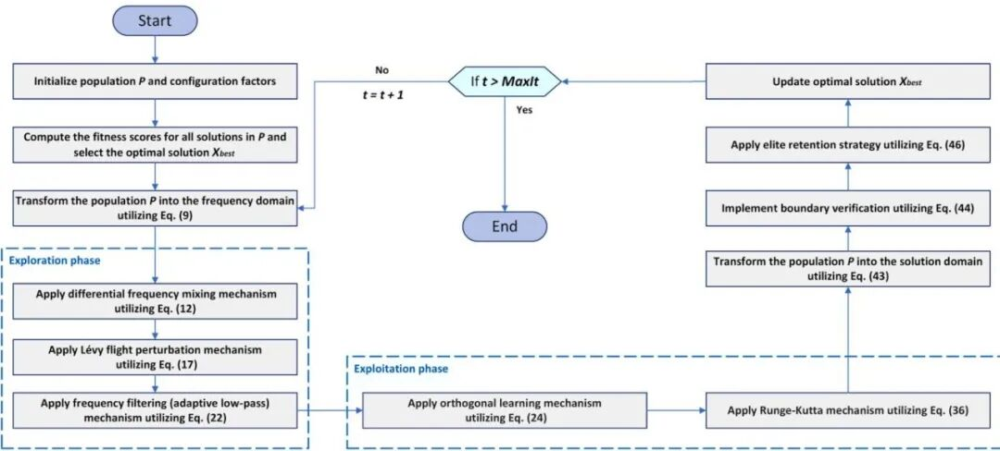
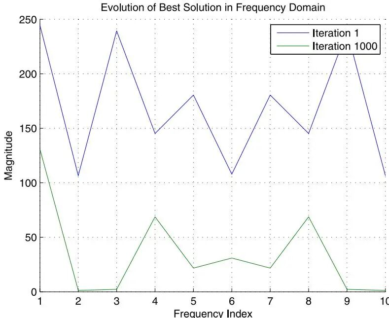
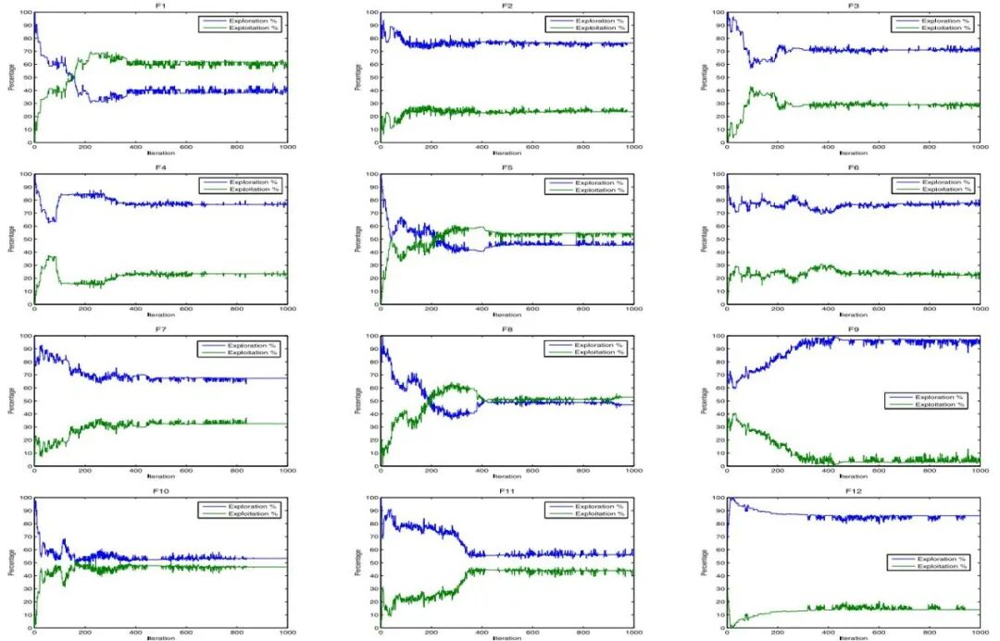
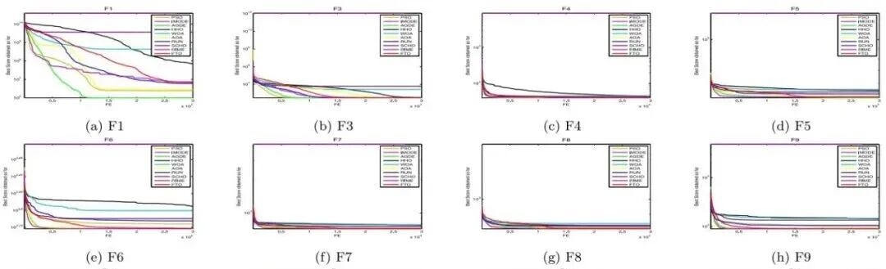

# 2026 Top Optimization! Fourier Transform Optimization Algorithm FTO, Detailed Explanation of Principles + Search Distribution Map, Population Diversity, and Analysis of Exploration vs. Development

Operating platform: MATLAB R2023a and above, no additional toolbox required, one-click operation.
Document interpretation
References: Fourier transform optimizer: A novel physics-inspired metaheuristic algorithm for optimization problems
In 2026, a paper published in the top-tier journal of the Chinese Academy of Sciences, "Knowledge-Based Systems," introduced a novel metaheuristic algorithm—the Fourier Transform Optimizer (FTO). It treats candidate solutions as discrete signals, performing searches and perturbations within the frequency domain before reverting to the time domain, completely bypassing the traditional algorithms' direct addition or subtraction in the coordinate space.
This article improves work - why is only convergence curve not enough?
The experience with SCI (Scientific Citation Index) knows that reviewers only say "This does not demonstrate any difference in the search mechanism of the algorithm" when they see a convergence curve. What truly convinces reviewers is multi-dimensional qualitative analysis—where has the algorithm moved within the search space? When did population diversity decrease? Was the transition between exploration and development smooth or abrupt? Answering these questions cannot be done solely by benchmark numbers. This paper adds:
Frequency domain blind zone of primitive heuristic algorithm
Existing metaheuristic algorithms—whether PSO's velocity update, WOA's bubble network, or GWO's hunting—almost universally perform position updates within the time/space coordinate system: directly performing addition, subtraction, multiplication, and division on variable values. This operation heavily relies on manual tuning for balancing global exploration with local exploitation, making it easy to prematurely fall into local optima once the search landscape becomes complex.
The Fourier Transform Optimizer (FTO) published in Knowledge-Based Systems (first-tier area, Chinese Academy of Sciences), completely rethinking the approach: treating candidate solutions as discrete time-domain signals, transforming them into the frequency domain through Discrete Fourier Transform (DFT), applying differential perturbations, Lévy flights, and low-pass filtering on the frequency components, and then restoring the positions through Inverse Discrete Fourier Transform (IDFT). The low-frequency components correspond to global search directions, while the high-frequency components correspond to local details—the frequency domain operations reconstruct the entire optimization process from a signal processing perspective.
7 Major core innovations, one by one analyzed:
① Frequency domain transformation (DFT) —Turning candidate solutions into signals
② Differential frequency mixing (Differential Frequency Mixing) —Frequency domain version of differential evolution
③ Lévy flight perturbation —Driven by heavy-tailed distributions for global jumps
④ Adaptive low-pass filtering (Adaptive Low-Pass Filtering) —Dynamically clipping high-frequency noise
⑤ Orthogonal learning (OL) —System borrowing global optimal information
⑥ Runge-Kutta refinement (RK) —Embedding fourth-order differential equation solver into the search
⑦ Elite retention (Elite Retention) —Locking the top 10% of individuals in each generation
Each generation directly retains the top 10% individuals based on fitness ranking to prevent random perturbations from covering discovered quality solutions, ensuring overall convergence monotonicity and avoiding the degradation phenomenon where "a good move is randomly covered."
Experimental performance
1. Benchmark Testing - CEC2022 & CEC2017 Dual Titles
In the benchmark tests against two modern benchmarks, CEC2022 (12 functions) and CEC2017 (30 functions), FTO outperformed 13 mainstream algorithms in Friedman comprehensive rankings, with a score of 1.4 points, significantly surpassing classic algorithms such as GWO, WOA, PSO, SCA, HHO, and improved versions of DE like LSHADE and JADE. It also led in terms of convergence speed and quality of optimal solutions.
Engineering Optimization - Winning in Welded Beams, Pressure Vessels, and Gearboxes
In the design problems of welded beams, FTO achieved the optimal cost of 1.72 (with a standard deviation of only 9.48×10⁻⁴), and its stability was the best among 14 compared algorithms; classic engineering problems such as pressure vessels, cantilever beams, and gearboxes also reached their respective tasks' optimal solutions.
Feature Selection - Friedman Ranking No.1 in 14 Medical Data Sets
In the medical feature selection task (14 datasets including heart disease, diabetes, cancer, etc.), FTO ranked first with an average Friedman rank of 2.27 (first place), demonstrating its generalization capability in discrete/mixed optimization scenarios by balancing classification accuracy and the number of selected features.
Follow the author for irregular updates on innovative and high-quality learning materials, articles, and code, fueling your research endeavors!

## Images

<!-- PAYMENT_BLOCK -->

## Get this dataset

- Payment link (Stripe): [Buy now](https://buy.stripe.com/3cs8yP7sY87d0vu9AB)
- Payment QR code: 

<!-- /PAYMENT_BLOCK -->
